<p align="center">
  <picture>
    <source media="(prefers-color-scheme: dark)" srcset="docs/images/banner-dark.svg">
    <source media="(prefers-color-scheme: light)" srcset="docs/images/banner-light.svg">
    
  </picture>
</p>

<p align="center">
  <a href="https://github.com/gabrielalberton/droidhand/releases/latest"></a>
  <a href="https://github.com/gabrielalberton/droidhand/actions/workflows/ci.yml"></a>
  <a href="LICENSE"></a>
  
  
</p>

<p align="center">
  <a href="#quick-start">Quick start</a> ·
  <a href="docs/setup.md">Setup guide</a> ·
  <a href="docs/tools.md">Tools</a> ·
  <a href="docs/architecture.md">Architecture</a> ·
  <a href="SECURITY.md">Security</a>
</p>

---

**DroidHand** lets an AI agent — Claude Code, Codex, or any [Model Context Protocol](https://modelcontextprotocol.io) client — **see and use your own Android phone**: read the screen, tap, type, open apps, and work in a separate background screen while you keep using the phone.

It runs on Android's **accessibility service**, so it does **not** need USB or wireless debugging left on, root, or a cable. The phone dials out to a small relay on your own computer or home server; nothing on the phone listens for connections.

## Highlights

| | |
|---|---|
| 👁️ **Reads the screen** | Compact accessibility tree with stable `@refs`, plus JPEG screenshots. |
| ✋ **Acts like a person** | Tap, long-press, swipe, scroll, type, keys, open apps and links. |
| 🪟 **Works in the background** | A second, virtual screen in a floating mini window — hide it and the agent keeps going behind an eye bubble. |
| 🛑 **You stay in charge** | Asks before touching your screen while you use it, floating Stop button, kill switch in the notification and Quick Settings. |
| 🔒 **Locked-phone aware** | Knows when the phone is locked; optional unlock with a PIN sealed in Android Keystore (off by default). |
| 🧾 **Audited** | Every call lands in an append-only audit log on your server; secrets are masked. |

<picture>
  <source media="(prefers-color-scheme: dark)" srcset="docs/images/architecture-dark.svg">
  
</picture>

## Quick start

You need a Linux (or macOS) machine with Node.js 20+ for the relay, an Android 11+ phone, and a private network between them (e.g. [Tailscale](https://tailscale.com) or your LAN).

**1 · Relay on your computer**

```bash
git clone https://github.com/gabrielalberton/droidhand.git && cd droidhand
deploy/setup.sh   # creates a token, builds the server, installs the droidhand-relay user service
tailscale serve --tcp=8787 tcp://127.0.0.1:8787   # let the phone reach the relay (it listens on loopback)
```

**2 · App on your phone** — download `droidhand-<version>.apk` from the [latest release](https://github.com/gabrielalberton/droidhand/releases/latest), install it, then in the app:

- **Connection** → relay address (`ws://<your-computer-ip>:8787`) and the token from `~/.config/droidhand/token`;
- **Permissions** → turn on the DroidHand accessibility service and allow notifications;
- optional, once over adb: `adb shell pm grant work.alberton.droidhand android.permission.WRITE_SECURE_SETTINGS`.

**3 · Register with your agent**

```bash
claude mcp add droidhand --scope user \
  -e DROIDHAND_TOKEN_FILE=$HOME/.config/droidhand/token \
  -- node "$PWD/mcp-server/dist/index.js"
```

Then ask: *"take a look at my phone's screen"*. The full walkthrough, Codex config and troubleshooting are in the **[setup guide](docs/setup.md)**.

## Working in the background

<picture>
  <source media="(prefers-color-scheme: dark)" srcset="docs/images/background-display-dark.svg">
  
</picture>

`bg_open` gives the agent its own virtual screen. Two methods:

- **Native** — Android's own overlay display. Works with debugging fully off; always visible.
- **Own window** — DroidHand's trusted virtual display, run by a tiny shell helper the relay starts over adb. Hideable, resizable, and it keeps working while the phone is locked. Needs wireless debugging on while it runs.

The agent can only work there while its controls are actually on your screen; if they cannot be shown, the session is closed. Details: [architecture](docs/architecture.md#background-display), [what works while locked](docs/locked-screen-findings.md).

## Safety

<picture>
  <source media="(prefers-color-scheme: dark)" srcset="docs/images/safety-layers-dark.svg">
  
</picture>

DroidHand gives software **full control of a phone**. Only use it on a device **you own**, keep the relay on a private network, and treat the token like a password. It works in the personal profile and does not touch, read or bypass a work profile / MDM. See **[SECURITY.md](SECURITY.md)** for the threat model and how to report a vulnerability.

## Repository

| Path | What |
|---|---|
| [`android/`](android/) | The DroidHand app (Kotlin, Jetpack Compose) |
| [`mcp-server/`](mcp-server/) | Relay daemon + MCP adapter (TypeScript) |
| [`deploy/`](deploy/) | Relay setup, systemd unit, phone install script |
| [`docs/`](docs/) | [Setup](docs/setup.md), [architecture & protocol](docs/architecture.md), [tools](docs/tools.md), [locked-screen findings](docs/locked-screen-findings.md), [design doc](docs/PRD.md) |
| [`scripts/release.sh`](scripts/release.sh) | Builds a signed release (APK, server tarball, checksums) |

## Status

**1.0** — used daily on a Galaxy S24 Ultra (Android 17, One UI). Other phones should work but are less tested; reports are welcome. On the roadmap: reading notifications, ADB-on-demand sessions started from the phone itself, F-Droid. See the [changelog](CHANGELOG.md).

## Contributing

Issues and pull requests are welcome — please read [CONTRIBUTING.md](CONTRIBUTING.md) first.

## License

[Apache-2.0](LICENSE). Not affiliated with Google, Samsung, Anthropic, OpenAI or any project mentioned here.
