# Security

DroidHand gives software full control of a phone. This page describes what protects you, what does not, and how to report a vulnerability.

## Reporting a vulnerability

Please report privately — **do not open a public issue**.

- Open a [GitHub Security Advisory](https://github.com/gabrielalberton/droidhand/security/advisories/new) (preferred).

Include the component (app / relay / MCP adapter), version or commit, steps to reproduce and impact. We aim to acknowledge within a few days. Supported version: the latest release.

## Threat model in one paragraph

Whoever holds the **token** and can reach the **relay** controls the phone as if they were holding it, within what Android lets an accessibility service do. Whoever can run the agent can make it do anything the tools allow — including things you did not intend, if the agent is tricked by content on screen (prompt injection). DroidHand's job is to keep that power inside your private network, make it visible on the phone, and let you stop it instantly.

<picture>
  <source media="(prefers-color-scheme: dark)" srcset="docs/images/safety-layers-dark.svg">
  
</picture>

## What protects you

- **The phone only dials out.** The app opens no listening port. The relay listens on loopback; you expose its phone port only on a private network (Tailscale or LAN). Transport encryption comes from that network (WireGuard for Tailscale); the WebSocket itself is `ws://` unless you put TLS in front.
- **Shared token, fail closed.** Phone and agents authenticate with the same random token (`0600` file, never in git). No token configured → every connection is rejected. One phone session at a time.
- **Asks before using your screen.** While you are using the phone (screen on and unlocked), actions on the main screen wait for your OK on the phone (on by default).
- **Stop button.** A small red button floats while the agent acts; one tap cancels the current action and the agent is told (`stopped_by_user`).
- **No invisible background work.** The agent may only use a background display while its controls (Stop + window, eye bubble or handle) are actually on screen; otherwise the session is closed (`indicators_not_visible`).
- **Kill switches.** The notification's *Disconnect*, the Quick Settings tile and `panic_disconnect` end the session and close the background window at once.
- **Limited settings writes.** `set_setting` can only change the stay-awake and animation keys; it cannot turn debugging on.
- **Debugging off, ADB only on demand.** Everything works with USB/wireless debugging off. When a task needs adb (or the own-window helper), the agent opens a session: USB debugging goes on, the phone shows a *Turn ADB off* notification, and it goes off when the agent ends the session, 10 minutes after the agent's last call (enforced by the phone itself), or from any kill switch. While a session is open adbd also listens on TCP 5555 on every network the phone is on; only computers you have authorized (`adb pair` / *Allow debugging*) can connect.
- **Optional PIN unlock, off by default.** The PIN is encrypted with an AES-GCM key in Android Keystore and never leaves the phone; saving or showing it requires your biometric/device credential; one wrong attempt disables the feature.
- **Optional ADB fallback for PIN unlock.** On Android 14 or newer, the fallback needs separate acknowledgement and device verification. A dedicated phone-side helper receives the digits only for that session. The relay receives the result and an expiring, single-use challenge, never the PIN. Treat every computer authorized for ADB as trusted and revoke unfamiliar debugging authorizations from Android settings.
- **Audit log.** Every tool call is appended to `audit.jsonl` on your computer, with secrets masked.
- **No telemetry, no cloud.** Nothing is sent anywhere except between your phone and your relay.

## What it does not protect against

- A compromised computer running the relay or the agent.
- An agent you told to do something harmful, or one manipulated by what it reads on screen. Keep *Ask before using the main screen* on, watch the phone, and use Stop.
- Someone holding your unlocked phone. With PIN unlock enabled, also someone who controls the agent while the phone is locked.
- The own-window background display works **while the phone is locked** by design. If you enable the own-window helper, treat the relay as able to use apps without your PIN.
- An open ADB session gives the relay's computer shell-level access to the phone. Never tap *Allow* on a debugging prompt you do not recognize.

## Out of scope

No root, no exploits. DroidHand runs in the personal profile and does not touch, read or bypass a work profile, MDM or a device administrator's visibility.

## Your responsibilities

- Use it only on a device you own.
- Keep the token (and any adb keys) private; rotate the token if it leaks (`deploy/setup.sh` after deleting `~/.config/droidhand/token`, then update the app).
- Never expose the relay port to the internet.
- Follow any employer/MDM policy that applies to your device.
