# Architecture

<picture>
  <source media="(prefers-color-scheme: dark)" srcset="images/architecture-dark.svg">
  
</picture>

DroidHand has three moving parts:

| Part | Where | What it does |
|---|---|---|
| **MCP adapter** (`mcp-server/dist/index.js`) | your computer, one per agent session (stdio) | Exposes the [tool catalog](tools.md) over MCP and forwards each call to the relay over a loopback *control* socket. Binds no port. |
| **Relay daemon** (`mcp-server/dist/daemon.js`) | your computer, always on (systemd user service) | Holds the single phone session, correlates commands and results, runs the few *local* tools (own-window helper, suggestions, panic) and writes the append-only audit log. |
| **DroidHand app** (`android/`) | the phone | Dials out to the relay, runs each tool through its accessibility service and enforces the on-device safety rules. |

The phone is always the client. Nothing on the phone accepts connections, and the relay listens on loopback by default; expose its phone port only over a private network (e.g. `tailscale serve --tcp=8787 tcp://127.0.0.1:8787`).

## A tool call, end to end

```
agent ──tools/call tap {ref:"@4"}──► adapter ──control ws──► relay ──cmd──► app
                                                              │            │ guards: Stop pending? display allowed?
                                                              │            │         user on the phone → ask first
                                                              │            │ ScreenTools → accessibility gesture
agent ◄──────────── result ◄──────── adapter ◄────────────── relay ◄─result─┘
                                                              └─► audit.jsonl (args redacted)
```

1. The adapter validates arguments against the zod schema from the catalog.
2. The relay assigns an id, sends a `cmd` frame and waits up to `DROIDHAND_CMD_TIMEOUT_MS` (15 s).
3. On the phone, `ToolRouter` applies the guards in order:
   - a **Stop** the user tapped since the last call is reported once (`stopped_by_user`);
   - a **background display** must be DroidHand's open session, with its controls visible;
   - on the **main screen**, while the user is using the phone, the app asks before acting (`awaiting_user` / `user_declined`);
   - acting tools show the floating Stop button.
4. The call goes to its tool group (`SystemTools`, `ScreenTools`, `AppTools`, `BackgroundTools`) and the result comes back as a `result` frame.

## Wire protocol (phone ⇄ relay)

One JSON text frame per message, each with a string `type` (source of truth: [`mcp-server/src/protocol.ts`](../mcp-server/src/protocol.ts)).

| Frame | Direction | Shape |
|---|---|---|
| `hello` | phone → relay, first frame, within 5 s | `{type, token, device: {model, androidSdk, appVersion, suggestionLogging}}` |
| `event` `welcome` | relay → phone | sent after a valid `hello`; `payload.device` is the phone's id on the relay |
| `cmd` | relay → phone | `{type, id, tool, args}` |
| `result` | phone → relay | `{type, id, ok, data?, error?}` |
| `event` | phone → relay | `{type, event, payload}` — e.g. `user_stop`, `device_info` |
| `req` | phone → relay | `{type, id, op, args?}` — a question to the relay itself, e.g. `relay_status` |
| `res` | relay → phone | `{type, id, ok, data?, error?}` — answer to a `req` (older relays ignore `req`) |
| `ping` / `pong` | both | liveness |

**Several phones.** One relay can serve several phones (see [setup](setup.md#several-phones)). Each phone has its own token, which also tells the relay which phone it is; a new session of the same phone replaces the old one. Agents pick the phone with the `device` argument (`list_devices` lists them); when more than one phone is connected and `device` is missing the call fails instead of guessing. `relay_status` (relay version, attached agent sessions, every phone and its state) is answered only for phones with `"role": "admin"`; the app shows it in **Relay**, read-only.

Close codes: **4000** session replaced or severed (`panic_disconnect`), **4001** no `hello` in time, **4003** bad token. With no token configured the relay rejects everyone. The app reconnects with backoff, and comes back after reboots and app updates together with its accessibility service.

## Inside the app

```
android/app/src/main/java/work/alberton/droidhand/
  a11y/         DroidHandAccessibilityService (facade) · ScreenReader · Gestures · ScreenCapture
  tools/        ToolRouter (guards) · ToolPolicy (pure rules) · System/Screen/App/BackgroundTools
  safety/       StopButton · MainScreenGate (asks before acting while you use the phone)
  bg/           BackgroundSession · MiniWindow · Bubbles (eye, close target, handle)
  unlock/       Unlocker · PinPad · WakeActivity           (opt-in PIN unlock)
  shell/        ShellMain (own-window helper, runs as the shell user) · ShellBridge
  relay/        RelayClient (WebSocket, reconnect)
  service/      RelayService (foreground service + notification) · KillSwitchTile
  adb/          AdbSession (debugging on for a session, off on end/idle/kill switch)
  data/         Prefs · SecretStore (PIN, AES-GCM key in Android Keystore)
  ui/           Compose app: home/, settings/, components/, theme/
```

## Background display

<picture>
  <source media="(prefers-color-scheme: dark)" srcset="images/background-display-dark.svg">
  
</picture>

`bg_open` creates a second display; every tool then takes `display=<id>` to work there instead of on your screen.

| | Native | Own window |
|---|---|---|
| How | `overlay_display_devices` (needs `WRITE_SECURE_SETTINGS`) | Trusted virtual display created by `ShellMain`, a helper the relay starts with `adb shell app_process` (`own_helper_start`) |
| Debugging | can be fully off | wireless debugging on while the helper runs |
| Window | drawn by Android, always visible | DroidHand's mini window: hide (eye bubble), resize, opacity, touch passthrough |
| Phone locked | blocked by the lock screen | keeps working (the display is "always unlocked") |
| Keys | enter only | back, home, recents, enter |

The agent may only use a background display while you can see it: before every call the app checks that the Stop button and the window, eye bubble or handle are really on screen, re-adds them if needed, and closes the session (`indicators_not_visible`) if that fails.

What works with the screen locked or off — and what doesn't — is measured in [locked-screen-findings.md](locked-screen-findings.md).

## ADB on demand

Debugging is off. `adb_session_begin` (handled by the relay) asks the app to turn **USB debugging** on, then runs `adb connect <phone-tailnet-ip>:5555` — adbd listens on TCP when it was switched with `adb tcpip`, so this works on mobile data too.

```
agent ─ adb_session_begin ─► relay ─ adb_enable ─► app: adb_enabled=1, notification "Turn ADB off"
                              relay ─ adb connect 100.x.y.z:5555 ─► adbd
agent ─ adb_shell "pm grant …" ─► relay ─ adb -s … shell ─► adbd
agent ─ adb_session_end ─► relay ─ adb_disable ─► app: adb_enabled=0 (developer options restored)
```

- **Fallback:** every agent tool call renews a 10-minute idle deadline, kept both by the relay and by the app itself, so a lost connection never leaves debugging on. Kill switches also turn it off.
- **After a reboot** Android forgets the TCP port. The first session *arms* it: with the phone on any Wi-Fi, the app turns wireless debugging on and reports the ports listening on loopback; the relay connects to the wireless-debugging one (the computer must have been paired once), runs `adb tcpip 5555` and turns wireless debugging off again.
- `own_helper_start` opens a session if none is open; the helper dies when it ends.

## Host side

```
mcp-server/src/
  index.ts / daemon.ts   entry points (adapter, relay)
  catalog/               tool definitions by area  →  docs/tools.md (npm run docs:tools)
  relay/server.ts        phone-facing WebSocket
  control/               adapter ⇄ daemon channel
  core/                  routing, local tools, audit log, suggestions, adb helper
  mcp/server.ts          MCP server built from the catalog
```

State lives under `$XDG_STATE_HOME/droidhand/` (`audit/audit.jsonl`, `suggestions/suggestions.jsonl`; audit lines carry the `device`); the token in a `0600` file (default `~/.config/droidhand/token`), the phones in `~/.config/droidhand/devices.json` when there is more than one.

## Design history

[PRD.md](PRD.md) is the original design document. It describes the full vision, including parts that are not built yet (notification listener, on-device confirmation dialogs); the README and [tools.md](tools.md) describe what ships.
